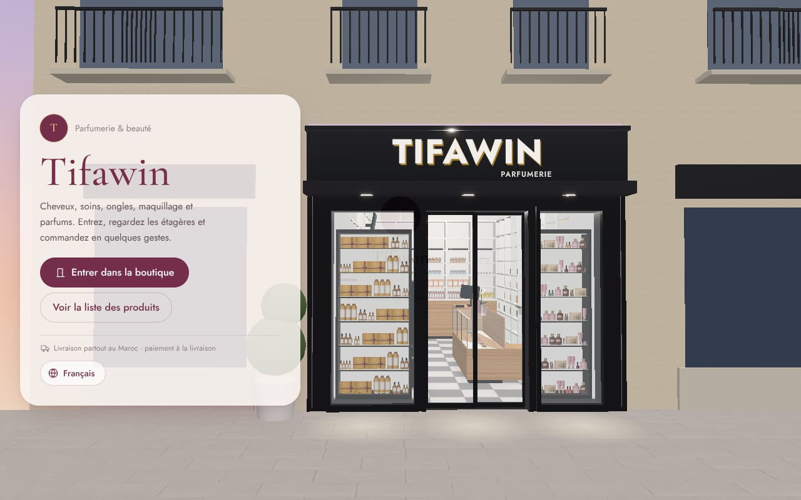
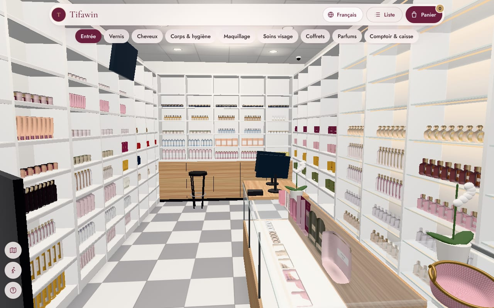
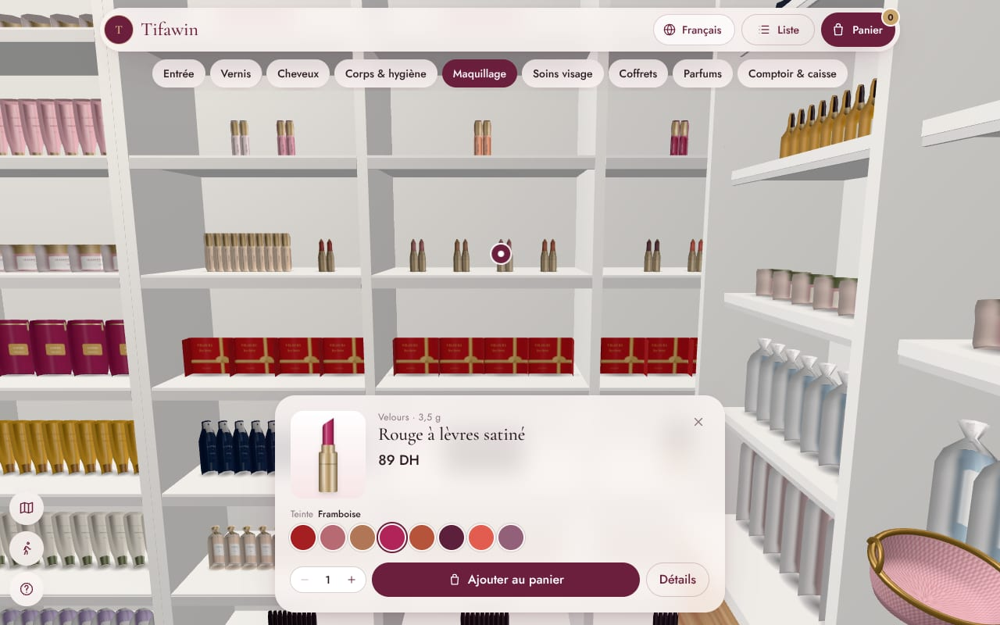
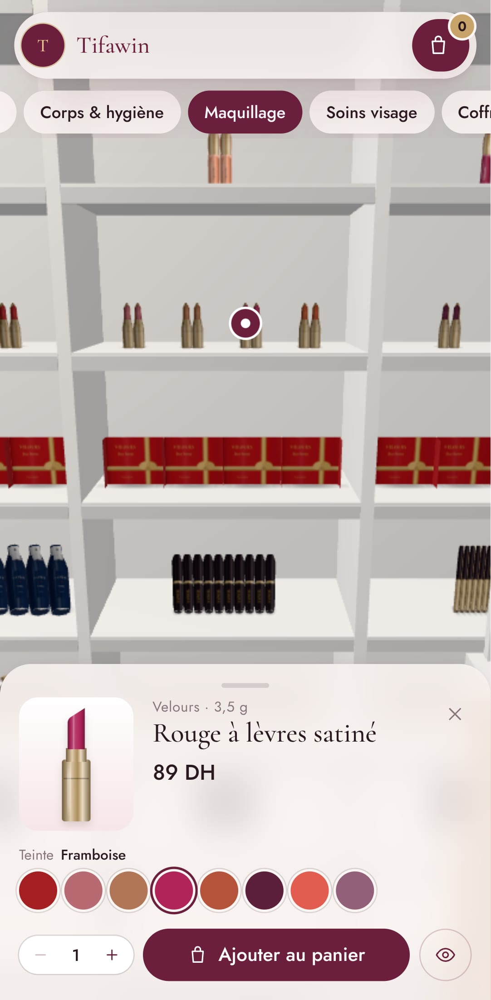

# Tifawin Parfumerie — a 3D beauty boutique you can shop from your phone

An immersive web shop for a small women's cosmetics boutique (about 3.5 m × 6.5 m). Customers
stand on the pavement in front of a black shopfront, watch the doors slide open, walk in, browse
the white wall shelving (hair, body and hands, makeup, skincare, gift sets, a perfume wall), a
nail-polish stand and a glass-topped counter, tap a product, pick a shade or a size, fill their
basket and **send the order straight to the shop on WhatsApp** — cash on delivery, anywhere in
Morocco. French, Arabic (right-to-left) and English.

The room follows the owner's photographs of a real perfumery (kept out of this public repository,
see `docs/reference/tifawin/README.md`): checkered floor, white ceiling grid with round downlights,
white shelving on three walls, glass counter on an oak base, a freestanding polish stand. Its sizes
are **estimates** (see *Make it yours*). Every product stands on the shelf as a 3D package built
automatically from its photo (see *Product photos → 3D*).



| Inside the boutique | A product on its shelf | Phone |
|---|---|---|
|  |  |  |

> The shop is **Tifawin Parfumerie**. Its 81 products, their brands, prices and stock are still
> **fictional demo content**, and the WhatsApp number is a placeholder (`212600000000`). Replace them
> with the shop's own (see *Make it yours* and *Importing products*). The address and opening hours
> are empty until set in the admin.

---

## Run it

Requirements: [Node.js](https://nodejs.org) 20.19+ or 22.12+.

```bash
npm install
npm run dev
```

Open the address it prints (usually http://localhost:5173). That's it — the app runs in **demo
mode**, with no account or database.

| Page | What it is |
|---|---|
| `/` | The 3D boutique (street intro, then inside) |
| `/catalog` | The same products as a fast list, with search and filters (also the fallback for devices without 3D) |
| `/p/<product>` | A shareable product page with a "See it in the boutique" button |
| `/checkout`, `/order/<number>` | Checkout and order confirmation |
| `/admin` | The shop owner's back office |

Deep links: `/?product=edp-rose-de-damas` opens a product on its shelf, `/?zone=wall-perfume`
walks straight to a section. Add `?tier=low|medium|high` to force a graphics quality level.

## What's inside

**The boutique**
- Built to scale from three numbers (width, depth, ceiling). Change them in the admin and every
  shelf, camera stop and collision box rebuilds itself. Room sizes from 2.8 × 4.5 m up are checked
  (no overlapping furniture, a walkable aisle of at least 0.75 m).
- Fixtures, as in the photos:
  - left wall: tall white shelving in three runs (hair, body and hands, makeup);
  - back wall: shelving over a light-oak base cabinet (skincare);
  - right wall: the perfume wall with glass shelves and lit bays, then gift sets;
  - a glass-topped counter on an oak base along the right wall, with the till at its far end and a
    lit vitrine under the glass;
  - a freestanding stepped nail-polish stand near the entrance;
  - a black-framed display in each shop window, facing the street (featured products).
- Checkered floor, white 60 cm ceiling grid with round downlights, neutral white light.
- A black shopfront with a raised, lit sign. Its title, subtitle and logo are set in the admin;
  nothing from the photographed shop's sign is hard-coded.
- The "no 3D" fallback (`/catalog`) lists every product and sells them the same way.

**Shopping**
- Tap a section in the bar (or a shelf) and the camera glides there. Drag to slide along the shelf,
  pinch or scroll to get closer. There's also a free-walk mode (arrow keys/WASD, or a joystick on
  touch screens) with collisions.
- Every product sits on its shelf at its real size, with as many facings as fit. Products with
  shades (nail polish, lipsticks, gloss) show every shade on the shelf.
- A product card with price, offers, low-stock and out-of-stock states, a shade or size picker, and
  quantity. A details dialog adds the description, how to use and related products.
- Added products fly into the basket carried at the bottom of the screen.
- The basket drawer shows a free-delivery meter, then checkout: name, phone (Moroccan and
  international numbers validated), city with its delivery fee and delay, address, notes, preferred
  time and consent.
- The confirmation page shows a big **"Send my order on WhatsApp"** button with the full order
  already written in the customer's language.

**Back office (`/admin`)**
- **Dashboard:** orders today and this week, revenue, orders to confirm, best sellers, low stock.
- **Orders:**
  - Filter and search.
  - A detail view with call and "confirm on WhatsApp" buttons (the message is written in the
    customer's language).
  - Statuses from new to delivered. Cancelling an order puts its items back in stock.
  - A printable delivery slip and CSV export.
- **Products:**
  - French, Arabic and English text; shades and sizes, price, offers and stock.
  - A photo upload that becomes a 3D package automatically after saving, with a status
    (*Waiting*, *Preparing image*, *Preparing 3D*, *Ready*, *Needs review*, *Failed*), a live 3D
    preview, the notes of the processing, and *Retry*. The list filters products by this status.
  - Overrides for everything automatic: package type, size, shelf, position, orientation (upright
    or flat), facings and display scale.
- **Shelves:** a to-scale front view of each fixture with the real packshots. Move products along a
  shelf or between shelves, change their facings, or place new ones.
- **Delivery:** cities, fees and delays; free-delivery threshold.
- **Settings:**
  - Shop name, tagline, address, hours, Instagram.
  - The WhatsApp number that receives orders, order prefix, currency.
  - Shop dimensions, the shopfront sign (title, subtitle, logo) and the section names.

**Two modes**

| | Demo (default) | Live (Supabase) |
|---|---|---|
| Catalog | `public/data/catalog.json` | Postgres tables |
| Orders | Sent by WhatsApp; kept in the customer's browser | Saved by `place_order()`, owner alerted by Telegram/email, **and** sent by WhatsApp |
| Admin | Works fully, but changes stay in *your* browser (export `catalog.json` from Settings to publish them) | Real accounts; changes are live for everyone |
| Setup | None | ~20 minutes, free tier (below) |

---

## Make it yours

The fastest path is the admin, at `/admin`:
1. **Settings:** shop name, WhatsApp number (international format, e.g. `212612345678`), address,
   hours, shop dimensions, sign texts.
2. **Delivery:** your cities and fees.
3. **Products:** edit or delete the demo products and add yours.
   - Photograph each product from the front on a **plain white or light-grey background** (or
     upload a transparent PNG). The background is removed automatically; busy or coloured
     backgrounds are refused and the product is flagged *Needs review*.
   - Sizes are estimated from the label ("50 ml") and the photo's proportions and marked as
     estimates. Enter the real **width, height and depth in cm** and tick *Measured* when you can.
4. **Shelves:** new products are placed automatically; move anything you like.

**The room's sizes are estimates.** The default 3.5 × 6.5 m, 3 m ceiling comes from the owner's
"3 or 4 m by 6 or 7 m". Measure the shop and enter the real numbers in *Settings → Shop*. Shelf
heights, bay widths, counter and stand sizes are estimates read from the photos; they live in one
object, `SHOP` at the top of `src/lib/layout.ts`.

In demo mode, publish your edits by exporting `catalog.json` (Settings → *Export catalog.json*),
replacing `public/data/catalog.json` with it and redeploying. In live mode, edits are instant.

For developers:
- `scripts/catalog/source.ts` is the source of the demo catalog. `npm run gen:catalog` redraws the
  packshots (headless Chromium) and rewrites `catalog.json`.
- `src/lib/layout.ts` is the floor plan: which fixture goes on which wall, the shelf heights and
  the camera stops. It's covered by unit tests for several room sizes.
- `src/lib/packaging.ts` is the package library; `src/lib/auto-placement.ts` decides which
  fixture each package family and category goes to.
- `src/styles.css` holds the design tokens (colours and fonts). The 3D palette is in
  `src/three/materials.ts`.

## Product photos → 3D

Every product is drawn as a **package family** (33 of them: perfume bottles of several shapes,
tall, pump, squeeze, flip-top, dropper and spray bottles, aerosols, roll-ons, jars, tubes,
lipsticks, glosses, mascaras, pencils, foundations, compacts, palettes, nail polish, cartons,
perfume boxes, gift sets, pouches, accessories). The model is a sweep of rounded cross-sections
along the product's outline, with the real photo projected on its front. Nothing is invented: when
the photo cannot be cut out, the product is shown as a flat card and flagged for review.

What happens when the owner saves a product with a new photo (`src/pages/admin/asset-job.ts`):

1. **Checks:** JPEG, PNG, WebP or AVIF (detected from the bytes, not the file name), 15 MB max,
   at least 120 px on the long side.
2. **The original is kept** untouched (browser storage in demo mode, `products/originals/` in the
   Supabase bucket in live mode).
3. **Cut-out:** a transparent PNG is used as is; a plain light or dark background is removed by a
   flood fill from the borders, keeping light areas inside the product (labels). A box photographed
   edge to edge is used whole as the box front.
4. **Outline and family:** the silhouette is measured (32 widths from cap to base) and the package
   family is inferred from the name (French and English keywords), the category and the outline.
5. **Size:** estimated from the volume on the label and the photo's proportions, unless entered.
6. **Model and shelf:** the 3D model is built in the browser from the family and the outline; the
   product is placed on a free shelf of the right fixture (polish on the polish stand, palettes
   flat under the counter glass, perfume on the perfume wall…) without overlapping anything.
7. **Status:** *Ready*, *Needs review* (with the reasons) or *Failed* (with the error, and *Retry*).

Saving never waits for this: the product is saved first and the job runs after.

**AI image-to-3D (optional, not configured).** `src/lib/product-assets/model-provider.ts` defines
the interface a real image-to-3D service would implement (submit, poll, fetch a GLB, validate it,
time out). No provider is configured, so every product uses the procedural package model, and the
admin says so. A provider must run server-side (for example a Supabase Edge Function), so its API
key never reaches the browser. Rendering a generated GLB in the shop is not wired yet.

The same pipeline runs in Node for the demo catalogue and for imports:

```bash
npm run assets:prepare                 # prepare products whose asset is missing or outdated
npm run assets:prepare -- --force      # all products
npm run assets:prepare -- --only=edp-rose-de-damas --replace-placements
```

## Importing products

`npm run import:products -- data/imports/<source>.manifest.json [--dry-run]` imports products from
a manifest you prepare from a supplier's price list or your own data:

- **Permission first.** The manifest records the permission to use the source's texts and photos
  (`permission.status: "granted"`, the basis and the licence). Anything else imports nothing.
- **Nothing invented.** A product without a price, a stock or a photo is imported **inactive**
  (not on sale) and listed in the report.
- **Idempotent.** Products are matched by source name and source id: a second run updates them.
- **Safe images.** Local files, or HTTPS downloads from the hosts listed in the manifest only.
  Each photo goes through the pipeline above.
- **A report** is written to `docs/import-reports/<source>-<date>.json`: discovered, imported,
  updated, skipped, invalid, images unavailable, inactive, 3D ready, card fallbacks.

`data/imports/README.md` describes the format. **Zinabel** (zinabel.ma) was checked and **not
imported**: its terms of use forbid reusing its texts, images and databases without written
authorisation. `data/imports/zinabel.manifest.json` records this; the blocked run's report is in
`docs/import-reports/`. With Zinabel's written agreement, or with your own supplier data and
photos, fill in a manifest and run the importer.

## Going live with Supabase (orders saved, owner alerts, shared admin)

1. **Create a project** at [supabase.com](https://supabase.com) (the free tier is enough).
2. **Create the tables.** In the SQL editor, run these files in order:
   - `supabase/migrations/20261026000000_boutique.sql` (tables, security rules, order functions)
   - `supabase/migrations/20261026000100_storage.sql` (the photo bucket)
   - `supabase/migrations/20261026000200_product_assets.sql` (package families, 3D asset and
     source columns; converts existing products)
   - `supabase/seed.sql` (the demo catalog; skip it to start empty, or regenerate it from your own
     `catalog.json` with `npx tsx scripts/generate-seed-sql.ts`)

   With the [Supabase CLI](https://supabase.com/docs/guides/cli) instead:
   `supabase link` then `supabase db push`.
3. **Create the owner's account.** Go to *Authentication → Users → Add user* (email + password),
   then run this in the SQL editor:
   ```sql
   insert into public.admins (user_id)
   select id from auth.users where email = 'owner@example.com';
   ```
4. **Connect the app.** Copy `.env.example` to `.env` and fill in `VITE_SUPABASE_URL` and
   `VITE_SUPABASE_ANON_KEY` (*Project Settings → API*). Restart `npm run dev`. The admin now asks
   for the owner's login.
5. **Order alerts (optional).** Deploy the edge function:
   ```bash
   supabase functions deploy notify-order
   supabase secrets set WEBHOOK_SECRET=<long random string> \
     TELEGRAM_BOT_TOKEN=<from @BotFather> TELEGRAM_CHAT_ID=<your chat id> \
     RESEND_API_KEY=<optional> ORDER_EMAIL_TO=<you@…> ORDER_EMAIL_FROM=<orders@your-domain>
   ```
   Then go to *Database → Webhooks → Create a new hook* and set it up as follows:
   - **Table:** `orders`. **Event:** `INSERT`.
   - **Type:** Supabase Edge Function, pointing at `notify-order`.
   - **HTTP header:** `x-webhook-secret: <the same secret>`.

**Security model**
- Customers can only read the active catalog. They can't touch any table directly.
- The only write a customer can make is calling `place_order()`, which does the following:
  - re-prices every line from the database (prices sent by the browser are ignored)
  - checks and decrements stock in one transaction
  - throttles each phone number to 5 orders an hour
  - rejects bots through a honeypot field
- Only admins can read orders or edit the catalog, settings and photos.
- `tests/unit/sql.test.ts` runs the real migration in PGlite (Postgres in WebAssembly) to check all
  of this.

## Deploy

The build is static files, so any static host works.

```bash
npm run build      # → dist/ (also pre-renders /p/<product>/ pages with link previews)
npm run preview    # check the production build locally
```

- **Vercel:** import the repo; `vercel.json` is included.
- **Netlify:** import the repo; `netlify.toml` and `public/_redirects` are included.
- **GitHub Pages:**
  1. Set *Settings → Pages → Source* to **GitHub Actions**.
  2. Push to `main`. `.github/workflows/deploy-pages.yml` publishes to
     `https://<user>.github.io/<repo>/`.
  3. For live mode, add the two `VITE_SUPABASE_*` values as repository secrets.

Set `SITE_URL` (e.g. `https://boutique.ma`) at build time, so product links shared on
WhatsApp or Instagram show the product photo and price. Use `VITE_BASE=/sub/path/` when the site
lives under a sub-path.

## Development

| Command | |
|---|---|
| `npm run dev` | Dev server with hot reload |
| `npm run build` / `npm run preview` | Production build / serve it |
| `npm run lint`, `npm run typecheck` | ESLint, TypeScript |
| `npm test` | Unit tests: layout, shelf packing, auto-placement, image pipeline, importer, pricing, WhatsApp message, **SQL + RLS in PGlite** |
| `npm run e2e` | Playwright: walk in → tap a shade on the shelf → order → WhatsApp link; deep links; walking; catalog; Arabic RTL; admin, including a new product photo → 3D → shelf → basket. Desktop and phone. |
| `npm run screenshots` | Tour of every section, desktop and phone, into `docs/screenshots/` |
| `npm run gen:catalog` | Redraw demo packshots and `catalog.json` (`-- --data-only` keeps the packshots) |
| `npm run assets:prepare` | Run the photo → 3D pipeline on `catalog.json` |
| `npm run import:products -- <manifest>` | Import products from a permitted source |
| `npm run assets:textures` | Re-download the Poly Haven textures |

The browser tests need Chromium: run `npx playwright install chromium` once, or point
`CHROMIUM_PATH` at an existing Chromium.

```
src/
  three/        3D scene: Boutique (canvas), Room, Facade, Fixtures, Decor, Products (atlas + instancing),
                packageGeometry (package models + shader), CameraRig + rig.ts (guided glides, walking,
                intro), Basket (fly-to-basket), Lighting, Effects
  ui/           Overlay: Header, ZoneBar, ProductSheet, ProductDetails, CartDrawer, Checkout, Landing, MiniMap…
  pages/        Store, Catalog, Product, Checkout, Order, admin/*
  lib/          layout.ts (floor plan), shelf-layout.ts (packing), packaging.ts (package families),
                product-assets/ (cut-out, silhouette, family, sizes, model provider), auto-placement.ts,
                pricing, whatsapp, data-source (demo | Supabase)
  state/        zustand stores: catalog, cart (persisted), ui
  i18n/         fr, ar, en
public/         catalog.json, product packshots, CC0 textures
supabase/       migrations, seed, notify-order edge function
scripts/        catalog + packshot generator, asset preparation, importer, seed generator, link previews
data/imports/   import manifests (one per source, with its permission)
tests/          unit (Vitest), e2e (Playwright)
docs/           video analysis, build prompt, research, redesign plan, reference photos, import reports, screenshots
.claude/skills/ Claude Code skills used to build this (three.js pack, frontend-design, webapp-testing)
```

**Stack.** React 19, Vite 8, TypeScript, Tailwind 4, three.js r186, React Three Fiber 9, drei 10,
postprocessing, GSAP (with SplitText), Motion, zustand, react-hook-form + zod, i18next, and
Supabase. Dependencies are pinned to exact versions.

**Performance.** Measured on the low tier with the 81 demo products: about 150–175 draw calls
and 230–250k triangles.
- Every product's photo is packed into texture atlases; each product is one instanced mesh per
  atlas page, whatever its number of facings.
- Package models have three detail levels (the device's quality tier picks one).
- Fixtures are merged per material.
- There are no real-time shadows.

The device picks a quality tier: bloom and ambient occlusion on desktops, bloom on phones, and
none on weak devices. The tier adapts to the measured frame rate. Product images load in parallel,
about 900 KB in total.

**Accessibility.** The overlay is keyboard-operable with visible focus. `prefers-reduced-motion`
turns camera glides into cuts. Every product is also reachable from the list view.

## Credits

- Textures: [Poly Haven](https://polyhaven.com), CC0 (see `public/textures/CREDITS.txt`).
- Fonts: Cormorant Garamond, Jost and Tajawal (SIL Open Font License), via Fontsource.
- Demo products, brands and packshots are generated by `scripts/` and are fictional.
- Claude Code skills in `.claude/skills/`:
  [cloudai-x/threejs-skills](https://github.com/cloudai-x/threejs-skills) (MIT), and
  [anthropics/skills](https://github.com/anthropics/skills) `frontend-design` and `webapp-testing`
  (Apache-2.0).

## Not included yet

- **Baked lighting from Blender** (Route B in `docs/RESEARCH.md`). It would give softer, more
  realistic light. The current lighting is real-time and cheap.
- **A photoreal scan of the real shop** with Gaussian splats (Route C).
- **Generated 3D models.** The image-to-3D provider interface exists, but no provider is configured
  and the shop does not load GLB files yet; every product uses its procedural package model.
- **Real products and measurements.** The 81 products are fictional demo content and the room's
  sizes are estimates. The owner's photos and price list (or a permitted supplier feed) are needed.
- **Online card payment.** `payment_method` is ready for it; only cash on delivery is wired.
- **Automatic WhatsApp messages from the shop** through the WhatsApp Business API. Today the
  customer sends the pre-written message, and the owner replies from the admin.
