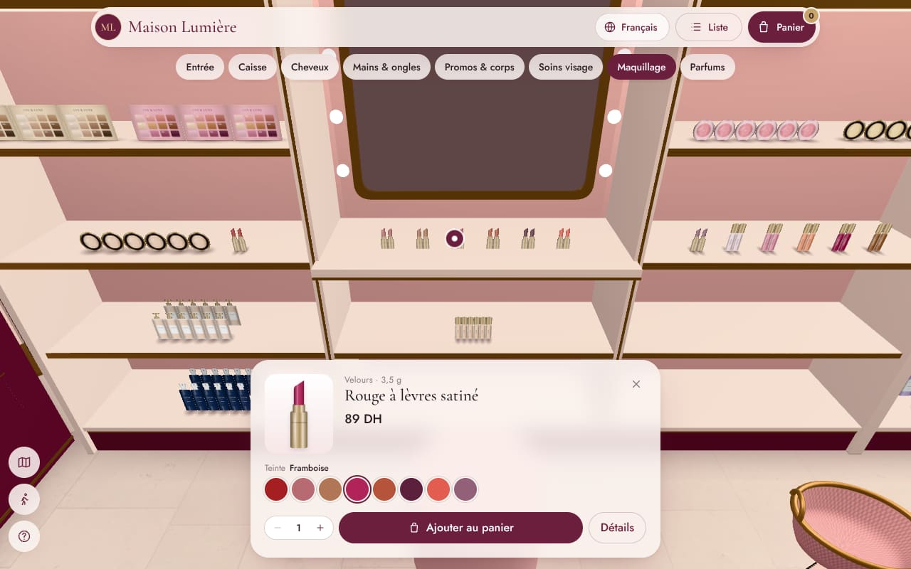
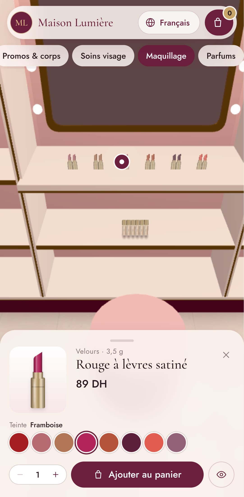

# Maison Lumière — a 3D beauty boutique you can shop from your phone

An immersive web shop for a small women's cosmetics boutique (3.5 m × 6.5 m). Customers stand on
the pavement, watch the doors slide open, walk in, browse real shelves (hair care, skincare,
hands & nails, makeup, a backlit perfume wall, an offers island), tap a product, pick a shade or a
size, fill their basket and **send the order straight to the shop on WhatsApp** — cash on
delivery, anywhere in Morocco. French, Arabic (right-to-left) and English.


| Inside the boutique | A product on its shelf | Phone |
|---|---|---|
|  |  |  |

> "Maison Lumière", its brands and its 81 products are **fictional demo content** so the shop can
> be shown without anyone's trademarks. Replace them with your own (see *Make it yours*).

---

## Run it

Requirements: [Node.js](https://nodejs.org) 20.19+ or 22.12+.

```bash
npm install
npm run dev
```

Open the address it prints (usually http://localhost:5173). That's it — the app runs in **demo
mode**, with no account or database.

| Page | What it is |
|---|---|
| `/` | The 3D boutique (street intro, then inside) |
| `/catalog` | The same products as a fast list, with search and filters (also the fallback for devices without 3D) |
| `/p/<product>` | A shareable product page with a "See it in the boutique" button |
| `/checkout`, `/order/<number>` | Checkout and order confirmation |
| `/admin` | The shop owner's back office |

Deep links: `/?product=edp-rose-de-damas` opens a product on its shelf, `/?zone=wall-perfume`
walks straight to a section. Add `?tier=low|medium|high` to force a graphics quality level.

## What's inside

**The boutique**
- Built to scale from three numbers (width, depth, ceiling). Change them in the admin and every
  shelf, sign, camera stop and collision box rebuilds itself.
- Fixtures: shelving walls with gold edges and LED strips, a stepped nail-polish rack, a makeup wall
  with a lit vanity mirror, three backlit perfume arches with glass shelves, a two-tier offers island
  under pendant lights, and a fluted counter with flowers and the shop's monogram.
- A Parisian-style plum shopfront with a striped awning, sliding glass doors, shop-window podiums
  showing featured products, and neighbouring facades at golden hour.
- Lighting from soft "light cards" baked into an environment map, wall washes, glowing downlights,
  contact shadows, and bloom plus ambient occlusion on capable devices. Free CC0 textures from
  Poly Haven.

**Shopping**
- Tap a section in the bar (or a shelf) and the camera glides there. Drag to slide along the shelf,
  pinch or scroll to get closer. There's also a free-walk mode (arrow keys/WASD, or a joystick on
  touch screens) with collisions.
- Every product sits on its shelf at its real size, with as many facings as fit. Products with
  shades (nail polish, lipsticks, gloss) show every shade on the shelf.
- A product card with price, offers, low-stock and out-of-stock states, a shade or size picker, and
  quantity. A details dialog adds the description, how to use and related products.
- Added products fly into the basket carried at the bottom of the screen.
- The basket drawer shows a free-delivery meter, then checkout: name, phone (Moroccan and
  international numbers validated), city with its delivery fee and delay, address, notes, preferred
  time and consent.
- The confirmation page shows a big **"Send my order on WhatsApp"** button with the full order
  already written in the customer's language.

**Back office (`/admin`)**
- **Dashboard:** orders today and this week, revenue, orders to confirm, best sellers, low stock.
- **Orders:**
  - Filter and search.
  - A detail view with call and "confirm on WhatsApp" buttons (the message is written in the
    customer's language).
  - Statuses from new to delivered. Cancelling an order puts its items back in stock.
  - A printable delivery slip and CSV export.
- **Products:**
  - French, Arabic and English text; photo upload, which warns when the photo has no transparent
    background.
  - Shades and sizes, price, offers and stock.
  - Shelf placement, with a live check that the product fits on the shelf.
- **Shelves:** a to-scale front view of each fixture with the real packshots. Move products along a
  shelf or between shelves, change their facings, or place new ones.
- **Delivery:** cities, fees and delays; free-delivery threshold.
- **Settings:**
  - Shop name, tagline, address, hours, Instagram.
  - The WhatsApp number that receives orders, order prefix, currency.
  - Shop dimensions and the shelf sign texts.

**Two modes**

| | Demo (default) | Live (Supabase) |
|---|---|---|
| Catalog | `public/data/catalog.json` | Postgres tables |
| Orders | Sent by WhatsApp; kept in the customer's browser | Saved by `place_order()`, owner alerted by Telegram/email, **and** sent by WhatsApp |
| Admin | Works fully, but changes stay in *your* browser (export `catalog.json` from Settings to publish them) | Real accounts; changes are live for everyone |
| Setup | None | ~20 minutes, free tier (below) |

---

## Make it yours

The fastest path is the admin, at `/admin`:
1. **Settings:** shop name, WhatsApp number (international format, e.g. `212612345678`), address,
   hours, shop dimensions, sign texts.
2. **Delivery:** your cities and fees.
3. **Products:** edit or delete the demo products and add yours.
   - For the photos, a front-facing **transparent PNG** looks best on the shelves. Remove the
     background first with any background-removal tool. Plain photos work but show as cards.
   - Enter each product's real **width and height in cm**, so it stands at the right size.
4. **Shelves:** arrange everything.

In demo mode, publish your edits by exporting `catalog.json` (Settings → *Export catalog.json*),
replacing `public/data/catalog.json` with it and redeploying. In live mode, edits are instant.

For developers:
- `scripts/catalog/source.ts` is the source of the demo catalog. `npm run gen:catalog` redraws the
  packshots (headless Chromium) and rewrites `catalog.json`.
- `src/lib/layout.ts` is the floor plan: which fixture goes on which wall, the shelf heights and
  the camera stops. It's covered by unit tests for several room sizes.
- `src/styles.css` holds the design tokens (colours and fonts). The 3D palette is in
  `src/three/materials.ts`.

## Going live with Supabase (orders saved, owner alerts, shared admin)

1. **Create a project** at [supabase.com](https://supabase.com) (the free tier is enough).
2. **Create the tables.** In the SQL editor, run these files in order:
   - `supabase/migrations/20261026000000_boutique.sql` (tables, security rules, order functions)
   - `supabase/migrations/20261026000100_storage.sql` (the photo bucket)
   - `supabase/seed.sql` (the demo catalog; skip it to start empty, or regenerate it from your own
     `catalog.json` with `npx tsx scripts/generate-seed-sql.ts`)

   With the [Supabase CLI](https://supabase.com/docs/guides/cli) instead:
   `supabase link` then `supabase db push`.
3. **Create the owner's account.** Go to *Authentication → Users → Add user* (email + password),
   then run this in the SQL editor:
   ```sql
   insert into public.admins (user_id)
   select id from auth.users where email = 'owner@example.com';
   ```
4. **Connect the app.** Copy `.env.example` to `.env` and fill in `VITE_SUPABASE_URL` and
   `VITE_SUPABASE_ANON_KEY` (*Project Settings → API*). Restart `npm run dev`. The admin now asks
   for the owner's login.
5. **Order alerts (optional).** Deploy the edge function:
   ```bash
   supabase functions deploy notify-order
   supabase secrets set WEBHOOK_SECRET=<long random string> \
     TELEGRAM_BOT_TOKEN=<from @BotFather> TELEGRAM_CHAT_ID=<your chat id> \
     RESEND_API_KEY=<optional> ORDER_EMAIL_TO=<you@…> ORDER_EMAIL_FROM=<orders@your-domain>
   ```
   Then go to *Database → Webhooks → Create a new hook* and set it up as follows:
   - **Table:** `orders`. **Event:** `INSERT`.
   - **Type:** Supabase Edge Function, pointing at `notify-order`.
   - **HTTP header:** `x-webhook-secret: <the same secret>`.

**Security model**
- Customers can only read the active catalog. They can't touch any table directly.
- The only write a customer can make is calling `place_order()`, which does the following:
  - re-prices every line from the database (prices sent by the browser are ignored)
  - checks and decrements stock in one transaction
  - throttles each phone number to 5 orders an hour
  - rejects bots through a honeypot field
- Only admins can read orders or edit the catalog, settings and photos.
- `tests/unit/sql.test.ts` runs the real migration in PGlite (Postgres in WebAssembly) to check all
  of this.

## Deploy

The build is static files, so any static host works.

```bash
npm run build      # → dist/ (also pre-renders /p/<product>/ pages with link previews)
npm run preview    # check the production build locally
```

- **Vercel:** import the repo; `vercel.json` is included.
- **Netlify:** import the repo; `netlify.toml` and `public/_redirects` are included.
- **GitHub Pages:**
  1. Set *Settings → Pages → Source* to **GitHub Actions**.
  2. Push to `main`. `.github/workflows/deploy-pages.yml` publishes to
     `https://<user>.github.io/<repo>/`.
  3. For live mode, add the two `VITE_SUPABASE_*` values as repository secrets.

Set `SITE_URL` (e.g. `https://boutique.ma`) at build time, so product links shared on
WhatsApp or Instagram show the product photo and price. Use `VITE_BASE=/sub/path/` when the site
lives under a sub-path.

## Development

| Command | |
|---|---|
| `npm run dev` | Dev server with hot reload |
| `npm run build` / `npm run preview` | Production build / serve it |
| `npm run lint`, `npm run typecheck` | ESLint, TypeScript |
| `npm test` | Unit tests: layout, shelf packing, pricing, WhatsApp message, **SQL + RLS in PGlite** |
| `npm run e2e` | Playwright: walk in → tap a shade on the shelf → order → WhatsApp link; deep links; walking; catalog; Arabic RTL; admin. Desktop and phone. |
| `npm run screenshots` | Tour of every section, desktop and phone, into `docs/screenshots/` |
| `npm run gen:catalog` | Redraw demo packshots and `catalog.json` |
| `npm run assets:textures` | Re-download the Poly Haven textures |

The browser tests need Chromium: run `npx playwright install chromium` once, or point
`CHROMIUM_PATH` at an existing Chromium.

```
src/
  three/        3D scene: Boutique (canvas), Room, Facade, Fixtures, Decor, Products (atlas + instancing),
                CameraRig + rig.ts (guided glides, walking, intro), Basket (fly-to-basket), Lighting, Effects
  ui/           Overlay: Header, ZoneBar, ProductSheet, ProductDetails, CartDrawer, Checkout, Landing, MiniMap…
  pages/        Store, Catalog, Product, Checkout, Order, admin/*
  lib/          layout.ts (floor plan), shelf-layout.ts (packing), pricing, whatsapp, data-source (demo | Supabase)
  state/        zustand stores: catalog, cart (persisted), ui
  i18n/         fr, ar, en
public/         catalog.json, product packshots, CC0 textures
supabase/       migrations, seed, notify-order edge function
scripts/        catalog + packshot generator, seed generator, link-preview pre-render, textures
tests/          unit (Vitest), e2e (Playwright)
docs/           video analysis, build prompt, research, screenshots
.claude/skills/ Claude Code skills used to build this (three.js pack, frontend-design, webapp-testing)
```

**Stack.** React 19, Vite 8, TypeScript, Tailwind 4, three.js r186, React Three Fiber 9, drei 10,
postprocessing, GSAP (with SplitText), Motion, zustand, react-hook-form + zod, i18next, and
Supabase. Dependencies are pinned to exact versions.

**Performance.** The whole boutique renders in about 105–120 draw calls:
- Every product on every shelf is packed into two or three texture atlases and drawn instanced.
- Fixtures are merged per material.
- There are no real-time shadows.

The device picks a quality tier: bloom and ambient occlusion on desktops, bloom on phones, and
none on weak devices. The tier adapts to the measured frame rate. Product images load in parallel,
about 900 KB in total.

**Accessibility.** The overlay is keyboard-operable with visible focus. `prefers-reduced-motion`
turns camera glides into cuts. Every product is also reachable from the list view.

## Credits

- Textures: [Poly Haven](https://polyhaven.com), CC0 (see `public/textures/CREDITS.txt`).
- Fonts: Cormorant Garamond, Jost and Tajawal (SIL Open Font License), via Fontsource.
- Demo products, brands and packshots are generated by `scripts/` and are fictional.
- Claude Code skills in `.claude/skills/`:
  [cloudai-x/threejs-skills](https://github.com/cloudai-x/threejs-skills) (MIT), and
  [anthropics/skills](https://github.com/anthropics/skills) `frontend-design` and `webapp-testing`
  (Apache-2.0).

## Not included yet

- **Baked lighting from Blender** (Route B in `docs/RESEARCH.md`). It would give softer, more
  realistic light. The current lighting is real-time and cheap.
- **A photoreal scan of the real shop** with Gaussian splats (Route C).
- **Online card payment.** `payment_method` is ready for it; only cash on delivery is wired.
- **Automatic WhatsApp messages from the shop** through the WhatsApp Business API. Today the
  customer sends the pre-written message, and the owner replies from the admin.
