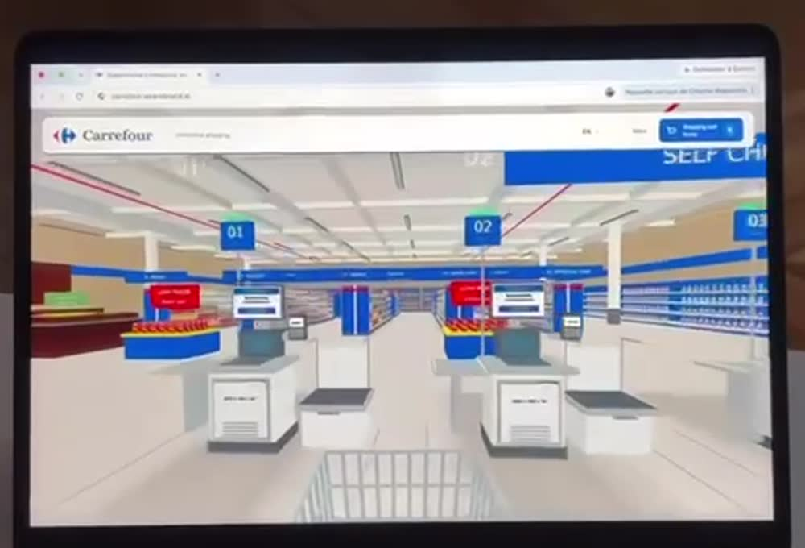
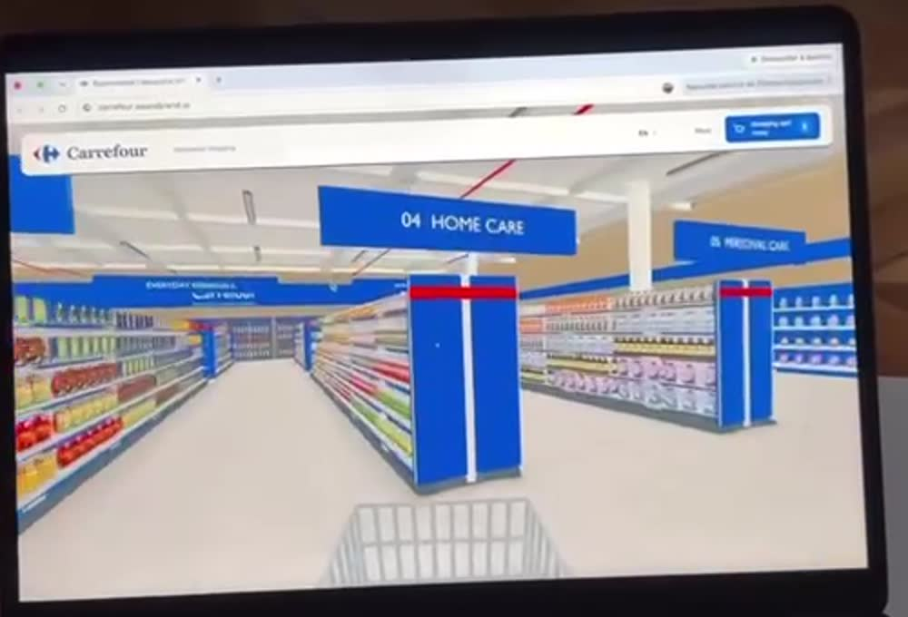
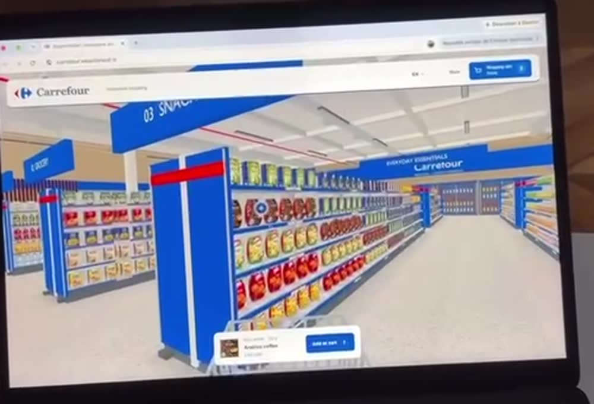
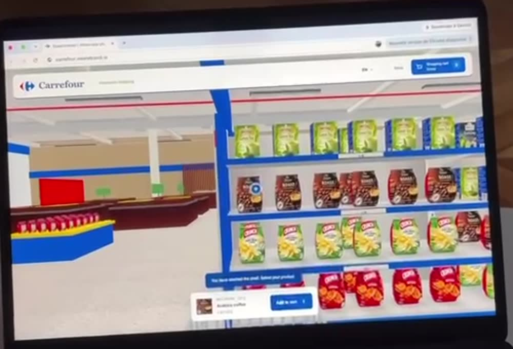
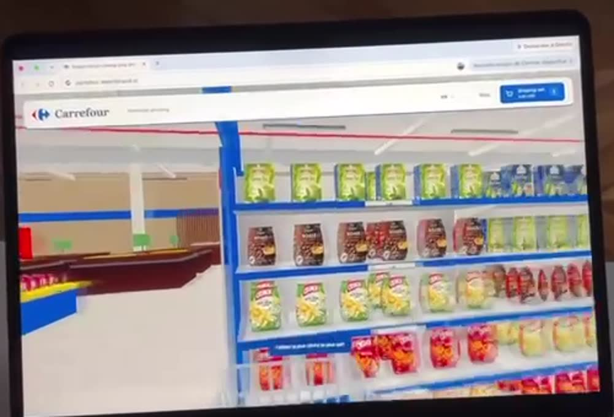
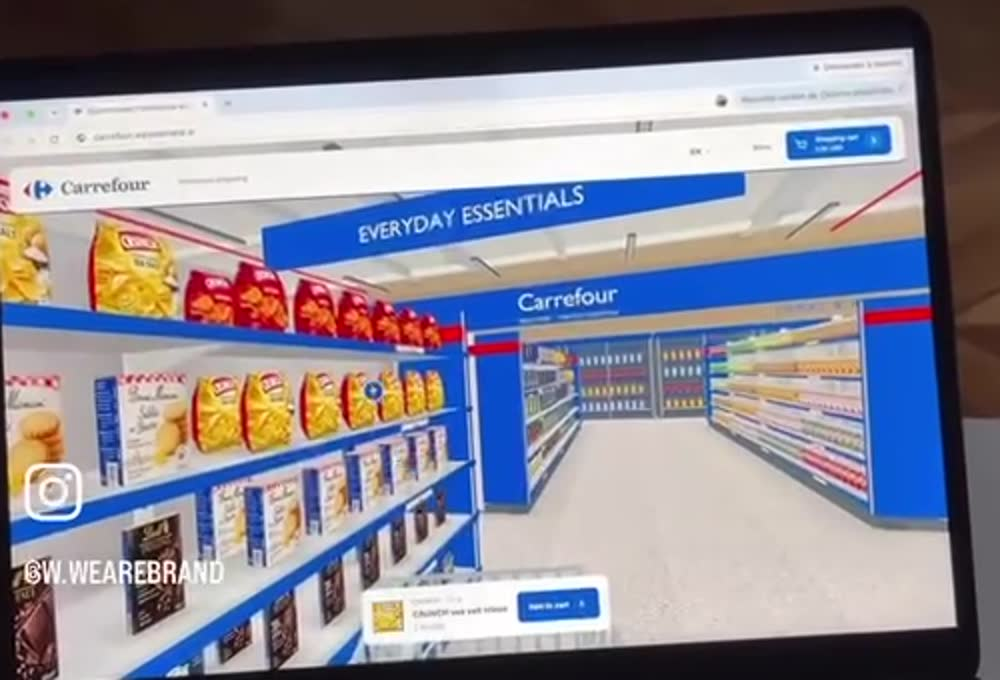

# Reference video analysis: Carrefour "Immersive shopping" (3D supermarket website)

Source: `WhatsApp_Video_2026-10-25_at_13.11.27.mp4` (17 s, 576×1024 portrait, 30 fps).
It's an Instagram reel captioned **"Websites in 2026"**, watermarked **@w.wearebrand**. It shows
someone using a 3D supermarket website on a laptop with a trackpad.

> The store in the video is **Carrefour**. The header says "Carrefour · Immersive shopping", and
> the address bar looks like `carrefour.wearebrand.io` (it's blurry). That points to a concept or
> prototype made by the agency *We Are Brand*, not to Carrefour's production site.
> Carrefour's name and logo are trademarks, so our build will use its own brand and products.

Reference frames are cropped to the laptop screen. They're in [`docs/reference/`](reference/).

| | |
|---|---|
|  |  |
|  |  |
|  |  |

---

## 1. Timeline: what the user does

| Time | What's on screen |
|---|---|
| 0–1 s | **Spawn point at the entrance**, looking past the **self-checkout lanes 01 / 02 / 03** (a "SELF CHECKOUT" sign hangs overhead). A **shopping cart sits in first person** at the bottom of the screen. On the left is a promo island with a red **"LOW PRICES"** sign. |
| 1–2 s | Moves forward into the store. Numbered **hanging aisle signs** come into view: `01 GROCERY`(?), `02 …`, `03 SNACKS`, `04 HOME CARE`. A back-wall banner reads **"EVERYDAY ESSENTIALS · Carrefour"**. |
| 2–3 s | Glides between gondolas under **`04 HOME CARE`** and **`05 PERSONAL CARE`**. |
| 3–4 s | Turns toward the **`03 SNACKS`** gondola. A **product card** appears at the bottom center with a thumbnail, brand/size line, **"Arabica coffee"**, a price and an **"Add to cart"** button. A blue circular **hotspot** marks the selected product on the shelf. |
| 4–6 s | The camera **moves to a fixed spot facing the shelf**. A blue hint chip says **"You have reached the shelf. Select your product."** The shelves hold green packs, coffee bags and CRUNCH chips (yellow and red). |
| 6–7 s | Clicks **Add to cart**. A blue toast confirms that the item was **"… added to your cart"**. The **Shopping cart** button in the header updates its total. |
| 7–9 s | Turns into the next aisle, with the **"EVERYDAY ESSENTIALS"** and **"HOME & BEAUTY"** zone banners overhead. |
| 9–11 s | Close-up of a shelf with chips, biscuit boxes and chocolate bars. The product card now shows **"CRUNCH sea salt crisps"**. Adds it and gets the toast **"CRUNCH sea salt crisps added to your cart"**. |
| 11–13 s | Turns around and moves on, with the cart still visible in the foreground. |
| 13–17 s | Outro: Instagram logo and **@W.WEAREBRAND** over a dimmed screen. |

---

## 2. UI layer (an HTML overlay on top of the 3D canvas)

1. **Floating header bar.** It's a rounded white card that doesn't span the full width and sits over the canvas.
   - Left side: logo and the tagline "Immersive shopping".
   - Right side: a **language selector** (`EN ▾`), a **Menu** link, and a **Shopping cart** pill button. The button is primary blue and shows a cart icon, the label "Shopping cart", the running **total**, and an **item-count badge**.
2. **Product card** (bottom center). It appears when a product is hovered or selected and shows:
   - a square thumbnail
   - a grey line with brand, category and pack size
   - the product name in bold
   - the price
   - a blue **"Add to cart"** button with a quantity indicator
3. **Hint and toast chips.** These are small blue pills above the product card. The video shows two kinds:
   - context hints, such as "You have reached the shelf. Select your product."
   - confirmations, such as "CRUNCH sea salt crisps added to your cart"
4. **Product hotspot.** A blue circle with a white dot that's drawn in the 3D scene over the product under the cursor.
5. **First-person cart.** A 3D wire cart attached to the camera at the bottom of the view. It works like the weapon in an FPS game: it constantly reminds you that you're shopping.

## 3. 3D environment

- **Style.** Clean, stylized, low-poly and brightly lit, with little visible shadowing. That's cheap to render and looks like baked or ambient lighting. Product packs are flat textured cards or thin boxes, so the scene runs in a browser on a laptop.
- **Palette.** Carrefour blue for the gondola end caps, signs and shelf edges. A red band tops each end cap. White shelves, a light grey floor, beige walls with a blue stripe, a white ceiling with light panels, and red diagonal pipes or cable trays.
- **Layout.**
  - The entrance faces the self-checkout kiosks (numbered, each with a screen and a bagging area).
  - Promo islands stand near the entrance.
  - Parallel numbered aisles each carry a **hanging category sign** (GROCERY, SNACKS, HOME CARE, PERSONAL CARE, …).
  - **Zone banners** hang across the aisles (EVERYDAY ESSENTIALS, HOME & BEAUTY).
  - Wall fridges and shelving line the back wall.
- **Gondola.** A double-sided shelving unit with 4–5 shelf levels. Each level has a blue price rail, and products are packed in repeated facings. Blue end caps carry a red top band.

## 4. Interaction model (inferred)

The movement in the video is **smooth and cinematic**: no head bob and no strafing. The user only
uses a trackpad. Taken together with the "You have reached the shelf" hint, this suggests **guided
navigation** rather than free WASD walking:

1. **Look around** by dragging (or with the trackpad).
2. **Click a shelf, aisle sign or floor spot.** The camera **moves smoothly to a set viewpoint in
   front of that shelf**, and a hint confirms when it arrives.
3. **Hover or click a product.** A hotspot appears and the bottom card fills with that product's details.
4. **Add to cart.** A toast confirms it and the header cart total updates.
5. You can probably reach checkout through the cart button, or by walking to the self-checkout lanes.

The video doesn't show whether the keyboard (WASD/arrows) also works. A good build should support
both: guided click-to-go as the default, and free movement for power users.

## 5. Likely tech (inferred)

The video can't prove it, but everything on screen fits a **web-native WebGL stack**:
**Three.js** or **React Three Fiber**, glTF assets, and an HTML/CSS overlay for the header, card
and toasts. The UI looks like crisp DOM text, not text rendered in the engine, which argues
against Unity WebGL. Repeated product facings point to **instancing** and a **texture atlas** for
product packs.

---

## 6. Proposed spec for our build

### Stack
- **Vite + React + TypeScript**
- **@react-three/fiber** with **@react-three/drei** for the scene, camera controls, `Html`, `useGLTF`
  and `Instances`
- **zustand** for state: cart, selected product, navigation target and UI hints
- Camera moves with `CameraControls` from drei, or with a tween to each viewpoint
- Optional: **@react-three/postprocessing** for subtle outlines on hover

### Data model
```ts
type Product = {
  id: string; name: string; brand: string; size: string;
  price: number; currency: string; image: string;          // pack texture
  aisleId: string; side: 'L' | 'R'; shelf: number; slot: number;
};
type Aisle = {
  id: string; number: number; label: string; zone: string;  // "03", "SNACKS", "EVERYDAY ESSENTIALS"
  position: [number, number, number]; length: number;
  viewpoints: { position: [number, number, number]; target: [number, number, number] }[];
};
type CartLine = { productId: string; qty: number };
```
The store layout is **data-driven**. Aisles, categories and products load from JSON, so later
they can come from a real catalog or an API.

### Features
**MVP**
- Procedurally built store from the layout JSON: floor, walls, ceiling, gondolas, aisle signs, zone
  banners, and checkout kiosks.
- Products drawn as instanced textured cards on the shelves.
- First-person camera with a cart model attached to it.
- Click a shelf or aisle to move the camera smoothly to its viewpoint, with a "You have reached the shelf" hint.
- Hover a product to show the hotspot; click it to open the product card.
- Add to cart, with a toast and a header cart total and badge.
- A cart drawer for changing quantities and removing items, with a checkout summary.

**Next**
- Free-walk mode with WASD and arrows, and collisions against gondolas.
- Search: "Find coffee" plots a path, guides the camera to the right shelf and highlights the product.
- A minimap or store directory for jumping straight to an aisle.
- Mobile: drag to look, tap to go, and a responsive bottom sheet for the product card.
- Promo islands and "LOW PRICES" end caps driven by data.
- Accessibility: an alternative 2D list or grid view of every aisle, keyboard focus on products,
  `prefers-reduced-motion` support (cut instead of animating the camera), and screen-reader labels
  on the overlay.
- Multiple languages (EN, FR, AR), matching the `EN ▾` selector in the reference.

### Performance targets
- At least 60 fps on a mid-range laptop and at least 30 fps on a mid-range phone.
- Fewer than about 150 draw calls: one instanced mesh per texture atlas, and merged static geometry.
- Product images packed into atlases and compressed (KTX2 or WebP). Load aisles lazily.
- Baked or simple lighting with no real-time shadows, as in the reference.

### Milestones
1. Scaffold the project (Vite, R3F, zustand), set up a static store shell, and add camera controls.
2. Build the gondola and shelf generator, then instance products from JSON.
3. Add product picking and the overlay UI: header, product card, toasts, cart drawer.
4. Add guided navigation (viewpoints, smooth moves, arrival hints) and the first-person cart.
5. Polish: signage, checkout area, promo islands, mobile controls, accessibility view, and performance.
